# Asistente Académico Inteligente - Ingeniería de Sistemas UNAB

Sistema de orientación académica y educación de precisión desarrollado para apoyar a los estudiantes del programa de Ingeniería de Sistemas de la Universidad Autónoma de Bucaramanga (UNAB) en la gestión de matrícula, consulta de estado académico, proyección de asignaturas, normativa institucional y recomendaciones de autoaprendizaje.

---

## Tabla de Contenidos

1. [Descripción del Proyecto](#1-descripción-del-proyecto)
2. [Arquitectura del Sistema](#2-arquitectura-del-sistema)
3. [Implementación de RAG (Retrieval-Augmented Generation)](#3-implementación-de-rag-retrieval-augmented-generation)
4. [Base de Datos Relacional (PostgreSQL)](#4-base-de-datos-relacional-postgresql)
5. [Servidor MCP y Endpoints de Webhook](#5-servidor-mcp-y-endpoints-de-webhook)
6. [Orquestación, Guardrails y Manejo de FAQ en n8n](#6-orquestación-guardrails-y-manejo-de-faq-en-n8n)
7. [Aplicación Móvil Android](#7-aplicación-móvil-android)
8. [Manual de Instalación y Despliegue](#8-manual-de-instalación-y-despliegue)
9. [Manual de Usuario](#9-manual-de-usuario)

---

## 1. Descripción del Proyecto

El proyecto resuelve la fragmentación de información académica a la que se enfrentan los estudiantes universitarios durante los procesos de inscripción de cursos, verificación de prerrequisitos, consulta de reglamentos y seguimiento de su rendimiento. Mediante una arquitectura híbrida que combina recuperación semántica sobre documentos oficiales (RAG) y consulta estructurada en tiempo real mediante Model Context Protocol (MCP), el sistema entrega respuestas personalizadas, verificadas y accionables desde una aplicación móvil Android.

### Alcance Funcional
* Consulta de historial académico, promedio ponderado, créditos aprobados y estado de matrícula.
* Proyección de asignaturas habilitadas para el siguiente semestre validando prerrequisitos y correquisitos.
* Resolución de dudas normativas sobre reglamento estudiantil, calendarios académicos y tarifas vigentes.
* Recomendaciones pedagógicas personalizadas orientadas al autoaprendizaje y éxito académico.
* Atención inmediata de preguntas frecuentes (FAQ) y protección mediante guardrails de entrada y ejecución.

---

## 2. Arquitectura del Sistema

### Diagrama de Arquitectura

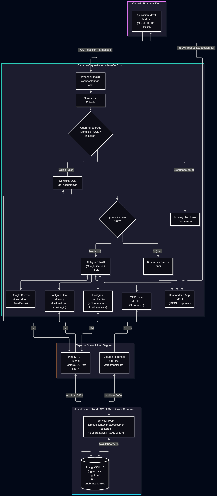

### Componentes Principales y Flujo de Datos

1. **Capa de Presentación (Aplicación Android):** Envía peticiones HTTP POST en formato JSON con el identificador de sesión (`session_id`) y la consulta del estudiante (`mensaje`) hacia el endpoint de producción de n8n.
2. **Capa de Orquestación (n8n Cloud):** Recibe la petición, normaliza las variables de entrada, ejecuta validaciones de seguridad (guardrails), evalúa coincidencias en la base de preguntas frecuentes y, de ser necesario, delega el razonamiento al agente de inteligencia artificial.
3. **Capa de Razonamiento (Google Gemini):** Procesa el lenguaje natural, selecciona dinámicamente las herramientas necesarias (búsqueda vectorial, consulta SQL mediante MCP o calendario) y redacta respuestas pedagógicas estructuradas.
4. **Capa de Conectividad Segura (Túneles Inversos):**
   * **Cloudflare Tunnel (`trycloudflare.com`):** Expone el servidor MCP local sobre HTTPS utilizando transporte `streamableHttp`, evitando problemas de tiempo de espera (HTTP 524/502) en conexiones persistentes.
   * **Pinggy TCP Tunnel:** Expone el puerto 5432 de PostgreSQL de forma segura para operaciones de memoria conversacional, almacenamiento vectorial (`pgvector`) y consultas de preguntas frecuentes.
5. **Capa de Persistencia y Herramientas (AWS EC2 + Docker):** Aloja los contenedores aislados de PostgreSQL 16 (con extensión `pgvector` y `pg_trgm`) y el servidor MCP (`@modelcontextprotocol/server-postgres` envuelto en `supergateway`).

### Justificación de Decisiones de Diseño

* **Separación entre datos estructurados (MCP) y no estructurados (RAG):** Los datos transaccionales (notas, créditos, estado de matrícula) requieren precisión exacta mediante consultas SQL, mientras que las normativas y contenidos programáticos requieren búsqueda semántica por similitud de vectores.
* **Servidor MCP en modo de solo lectura:** Garantiza que el modelo de lenguaje pueda inspeccionar el esquema relacional y ejecutar consultas `SELECT` sin riesgo de alterar, insertar o eliminar registros académicos.
* **Enrutamiento previo de FAQ antes del LLM:** Reduce la latencia de respuesta a milisegundos en consultas institucionales recurrentes y optimiza el consumo de cuota de la API del modelo de lenguaje.
* **Despliegue contenerizado con políticas de reinicio (`restart: unless-stopped`):** Asegura la disponibilidad automática de los servicios de base de datos, servidor MCP y túneles tras cualquier reinicio de la instancia en AWS EC2.

---

## 3. Implementación de RAG (Retrieval-Augmented Generation)

El pipeline de recuperación aumentada permite que el asistente fundamente sus respuestas en la documentación oficial de la Universidad Autónoma de Bucaramanga sin recurrir a generación especulativa.

### Documentos Institucionales Indexados

La base de conocimiento vectorial (`Documentos_RAG_UNAB`) está conformada por **27 documentos oficiales** en formato PDF y hoja de cálculo estructurada:

1. **Normativa y Gestión Académica:**
   * `Reglamento-estudiantil-pregrado.pdf` (Acuerdo No. 105 de 2019 — Derechos, deberes, matrícula, cancelaciones, estado académico y régimen disciplinario).
   * `CronogramaPregrado16sem_2026_II_ V1-E.pdf` (Calendario académico segundo semestre 2026).
   * `CronogramaPregradoProf2027_I_16SE-e.pdf` (Calendario académico primer semestre 2027).
   * `Calendario_Academico_UNAB_2026_2027` (Tabla estructurada de hitos, fechas de matrícula, pagos, cancelaciones y grados).
2. **Disposiciones Financieras:**
   * `CIRCULAR-305-TARIFAS-PREGRADO-2026.pdf` (Valores de crédito académico por programa y cohorte).
   * `CIRCULAR-296-TARIFAS-PECUNIARIOS-OTROS-CONCEPTOS-2026.pdf` (Derechos de grado, certificados, supletorios, habilitaciones y validaciones).
   * `Circular-312-Tarifas-proyectos-de-grado-2026-firmada.pdf` (Presupuesto y tarifas de trabajos de grado).
3. **Guías de Cátedra y Planes de Estudio (Ingeniería de Sistemas y Ciencias Básicas):**
   * **Línea de Computación y Software:** `PLAN_DE_ESTUDIO_FUNDAMENTOS_DE_PROGRAMACION.pdf`, `PLAN_DE_ESTUDIO_PROGRAMACION_DE_COMPUTADORES.pdf`, `PLAN_DE_ESTUDIO_ESTRUCTURA_DE_DATOS_Y_ANALISIS_DE_ALGORITMOS.pdf`, `PLAN_DE_ESTUDIO_BASE_DE_DATOS_1.pdf`, `PLAN_DE_ESTUDIO_BASE_DE_DATOS_2.pdf`, `PLAN_DE_ESTUDIO_INGENIERIA_DE_SOFTWARE.pdf`, `PLAN_DE_ESTUDIO_ARQUITECTURA_DE_SOFTWARE.pdf`, `PLAN_DE_ESTUDIO_INTELIGENCIA_ARTIFICIAL.pdf`, `PLAN_DE_ESTUDIO_DESARROLLO_MULTIMEDIA.pdf`, `PLAN_DE_ESTUDIO_DISEÑO_DE_INTERFACES.pdf`.
   * **Línea de Infraestructura, Redes y Seguridad:** `PLAN_DE_ESTUDIO_INFRAESTRUCTURA_TECNOLOGICA.pdf`, `PLAN_DE_ESTUDIO_INTERNET_DE_LAS_COSAS.pdf`, `PLAN_DE_ESTUDIO_CIBERSEGURIDAD.pdf`, `PLAN_DE_ESTUDIO_TECNOLOGIAS_MOVILES.pdf`.
   * **Línea de Ciencias Básicas e Investigación:** `PLAN_DE_ESTUDIO_ALGEBRA_LINEAL.pdf`, `PLAN_DE_ESTUDIO_CALCULO_DIFERENCIAL.pdf`, `PLAN_DE_ESTUDIO_CALCULO_INTEGRAL.pdf`, `PLAN_DE_ESTUDIO_CALCULO_EN_VARIAS_VARIABLES.pdf`, `PLAN_DE_ESTUDIO_ECUACIONES_DIFERENCIALES.pdf`, `PLAN_DE_ESTUDIO_ESTADISTICA_GENERAL.pdf`, `PLAN_DE_ESTUDIO_MECANICA_Y_LABORATORIO.pdf`, `PLAN_DE_ESTUDIO_ELECTROMAGNETISMO_Y_LABORATORIO.pdf`, `PLAN_DE_ESTUDIO_INVESTIGACION_DE_OPERACIONES_1.pdf`, `PLAN_DE_ESTUDIO_INVESTIGACION_DE_OPERACIONES_2.pdf`.
   * **Línea de Formación Integral, Proyectos e Idiomas:** `PLAN_DE_ESTUDIO_SEMINARIO_DE_INGENIERIA_1.pdf`, `PLAN_DE_ESTUDIO_SEMINARIO_DE_INGENIERIA_2.pdf`, `PLAN_DE_ESTUDIO_SEMINARIO_DE_INGENIERIA_3.pdf`, `PLAN_DE_ESTUDIO_PROYECTO_EN_INGENIERIA_DE_SISTEMAS_1.pdf`, `PLAN_DE_ESTUDIO_PROYECTO_EN_INGENIERIA_DE_SISTEMAS_2.pdf`, `PLAN_DE_ESTUDIO_PRACTICA_EN_INGENIERIA_DE_SISTEMAS.pdf`, `PLAN_DE_ESTUDIO_ETICA_DE_LA_INGENIERIA_DE_SISTEMAS.pdf`, y los syllabi de inglés (`PLAN_DE_ESTUDIO_INGLES_A1.pdf` hasta `PLAN_DE_ESTUDIO_INGLES_B2_2.pdf`).

### Parámetros de Vectorización y Justificación Técnica

| Parámetro | Valor Configurado | Justificación Técnica |
| :--- | :--- | :--- |
| **Motor Vectorial** | PostgreSQL 16 + `pgvector` | Centraliza los datos relacionales y los embeddings en una única instancia de base de datos, simplificando el respaldo, la seguridad y la consulta híbrida. |
| **Tamaño de Fragmento (`chunk_size`)** | `1000` caracteres | Mantiene la integridad semántica de artículos completos del Reglamento Estudiantil y secciones enteras de las Guías de Cátedra (justificación, competencias o contenidos) sin fragmentar reglas críticas. |
| **Solapamiento (`chunk_overlap`)** | `200` caracteres (20 %) | Evita la pérdida de contexto en los límites entre fragmentos, garantizando que los encabezados de artículos, códigos de materia y condiciones de prerrequisitos permanezcan vinculados al texto siguiente. |
| **Modelo de Embeddings** | Google Gemini Embeddings (`text-embedding-004` / `embedding-001`) | Ofrece representación semántica multilingüe de alta precisión en español técnico y académico, manteniendo compatibilidad nativa con el ecosistema de Gemini en n8n. |

### Evidencia del Pipeline RAG

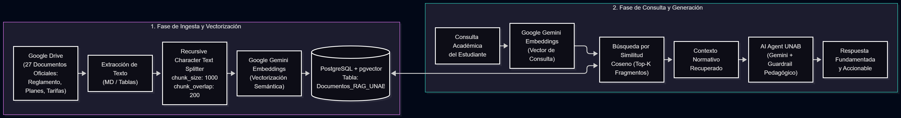

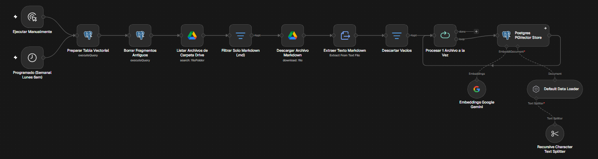
> **Descripción de captura:** Flujo de n8n encargado de la lectura de los documentos desde Google Drive, extracción de texto, división mediante *Recursive Character Text Splitter* (1000/200), generación de embeddings e inserción en la tabla vectorial de PostgreSQL.

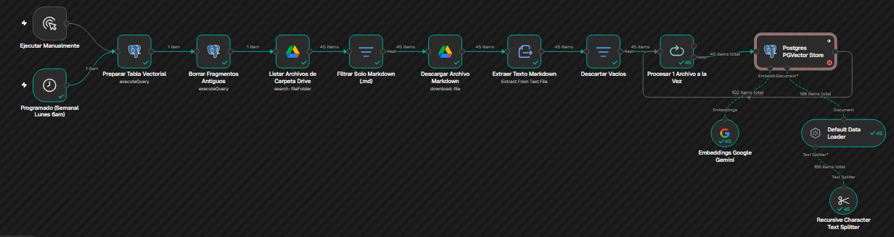
> **Descripción de captura:** Ejecución exitosa del agente recuperando información específica del Reglamento Estudiantil o de una Guía de Cátedra (por ejemplo, prerrequisitos o competencias de Arquitectura de Software) con citación coherente.

---

## 4. Base de Datos Relacional (PostgreSQL)

La base de datos `unab_academico` modela la información académica de los estudiantes, la malla curricular, el historial de calificaciones, las restricciones de prerrequisitos y el repositorio de preguntas frecuentes.

### Estructura de Scripts SQL en el Repositorio
* `database/schema.sql`: Definición de extensiones (`vector`, `pg_trgm`), tablas relacionales, llaves primarias, llaves foráneas y restricciones de integridad.
* `database/seed.sql`: Inserción de registros de prueba representativos (estudiantes, asignaturas de Ingeniería de Sistemas, prerrequisitos, matrículas actuales, historial de notas y preguntas frecuentes).

### Entidades Principales del Modelo
* `estudiantes`: Datos de identificación, programa, semestre actual, promedio acumulado y estado académico.
* `materias`: Catálogo de asignaturas con código institucional, nombre, número de créditos y semestre sugerido.
* `prerrequisitos`: Relación de precedencia académica entre asignaturas (`materia_id` y `prerrequisito_id`).
* `matriculas` y `historial_academico`: Registro de asignaturas inscritas en el período vigente y calificaciones obtenidas en períodos anteriores.
* `faq_academicas`: Banco de preguntas frecuentes categorizadas con palabras clave para resolución rápida.
* `n8n_chat_histories_unab`: Persistencia del historial de conversación por `session_id`.

### Modelo Entidad-Relación

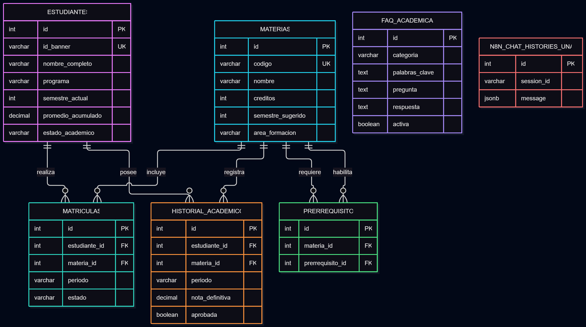

### Evidencia de Base de Datos en AWS EC2

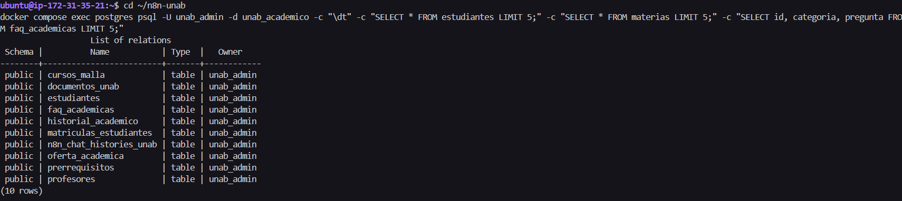
> **Descripción de captura:** Conexión por terminal SSH a la instancia AWS EC2 ejecutando `psql` dentro del contenedor Docker, mostrando el listado de tablas (`\dt`) y una consulta `SELECT` sobre las tablas pobladas con datos académicos.

---

## 5. Servidor MCP y Endpoints de Webhook

### Servidor MCP (`mcp-postgres`)
El servidor implementa el estándar **Model Context Protocol** mediante `@modelcontextprotocol/server-postgres` expuesto a través de `supergateway` bajo transporte `streamableHttp`.

* **Endpoint MCP:** `https://<subdominio-activo>.trycloudflare.com/mcp`
* **Modo de Operación:** Transacciones estrictas de solo lectura (`READ ONLY`).
* **Herramienta Expuesta (`query`):** Permite al agente inspeccionar el esquema de la base de datos y ejecutar consultas SQL parametrizadas para obtener notas, créditos aprobados y materias habilitadas del estudiante.

### Endpoint del Webhook (Integración Móvil)
* **Método:** `POST`
* **URL de Producción:** `https://<instancia>.app.n8n.cloud/webhook/unab-chat`
* **Cuerpo de Petición (JSON Request):**
  ```json
  {
    "session_id": "usuario_1",
    "mensaje": "¿Qué materias puedo matricular el próximo semestre según mi historial?"
  }
  ```

### Cuerpo de Respuesta (JSON Response)

```json
{
  "respuesta": "De acuerdo con tu historial académico...",
  "session_id": "usuario_1"
}
```

### Evidencia de Pruebas de MCP y Webhook

> **Descripción de captura:** Prueba de petición POST al endpoint del webhook de producción (mediante curl o Postman) mostrando código de estado HTTP 200 OK y la estructura JSON de respuesta generada tras consultar PostgreSQL vía MCP.

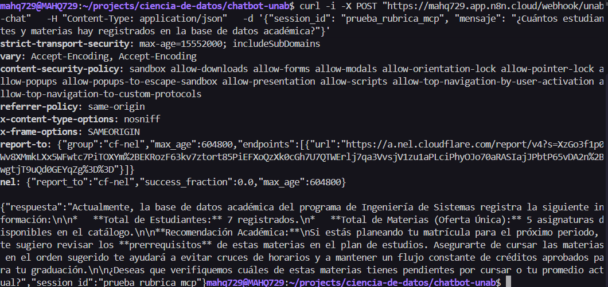

---

## 6. Orquestación, Guardrails y Manejo de FAQ en n8n

El flujo principal (Chatbot-Academico) integra controles de validación previos al modelo de lenguaje para garantizar seguridad, pertinencia temática y eficiencia operacional.

### Capas de Control Implementadas

* **Normalización de Entrada:** Estandariza los campos provenientes tanto del chat de pruebas interno de n8n como del webhook de la aplicación móvil (`chatInput`, `sessionId`, `esWebhook`).

* **Guardrail de Entrada (Nodo If):**
  * Valida longitud mínima y máxima del mensaje para descartar entradas vacías o desbordamientos.
  * Filtra mediante expresiones regulares intentos de inyección SQL (`DROP TABLE`, `DELETE FROM`, `TRUNCATE`, `ALTER TABLE`) y manipulación de instrucciones (Prompt Injection / Jailbreak).
  * Ante una detección positiva, bloquea la ejecución hacia el agente y devuelve un mensaje institucional controlado.

* **Enrutamiento de Preguntas Frecuentes (Nodo Execute a SQL query + If1):**
  * Consulta la tabla `faq_academicas` mediante coincidencia de palabras clave y similitud de trigramas (`pg_trgm`).
  * Si existe coincidencia, retorna la respuesta oficial directamente sin invocar al LLM.

* **Agente Académico con Guardrail Pedagógico (Nodo AI Agent UNAB):**
  * Restringe el dominio de respuesta exclusivamente al ámbito académico de Ingeniería de Sistemas UNAB.
  * Previene alucinaciones exigiendo verificación previa en MCP o PGVector antes de afirmar datos numéricos o normativos.
  * Estructura cada respuesta entregando el dato solicitado acompañado de una recomendación accionable de proyección o autoaprendizaje.

### Evidencia del Workflow en n8n Cloud

> **Descripción de captura:** Vista general del canvas en n8n Cloud donde se aprecian los nodos de entrada (Chat y Webhook), Normalización, Guardrail (If), Consulta FAQ (Postgres + If1), AI Agent UNAB con sus herramientas conectadas (Gemini, Postgres Memory, PGVector, MCP Client) y la salida hacia la app móvil.

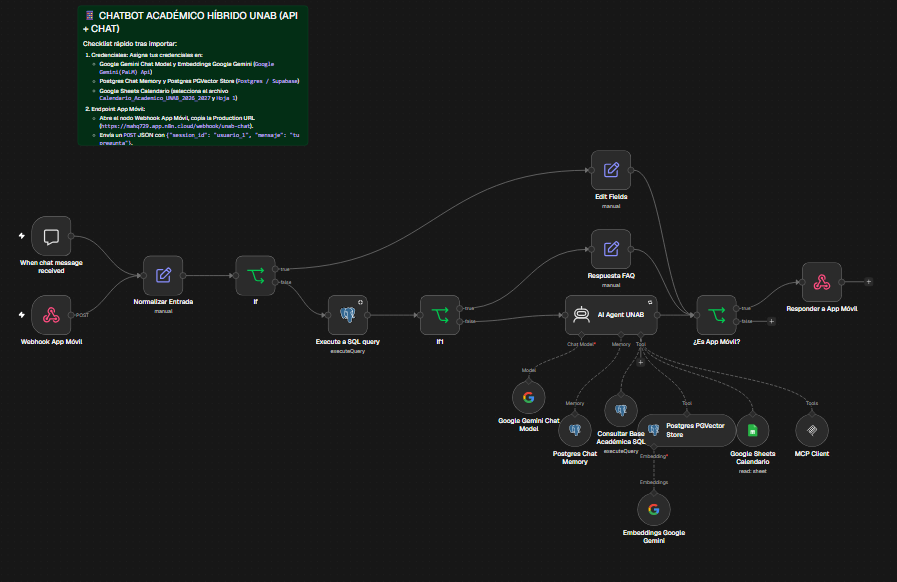

> **Descripción de captura:** Registro en la pestaña Executions de n8n mostrando una ejecución exitosa en verde donde el flujo enruta correctamente una consulta bloqueada por el guardrail o resuelta por el módulo de FAQ.

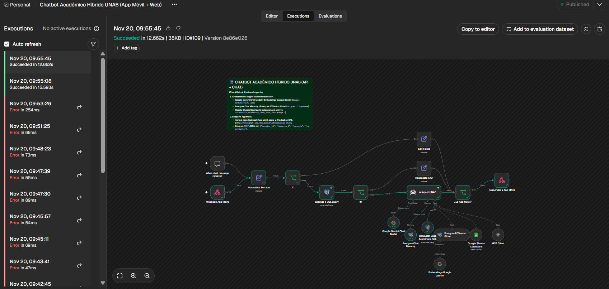

---

## 7. Aplicación Móvil Android

La aplicación móvil desarrollada en Android permite a los estudiantes interactuar de manera conversacional con el asistente desde cualquier dispositivo móvil, manteniendo la continuidad de la sesión mediante el envío del `session_id`.

### Funcionalidades Demostradas en la Aplicación

* **Consulta de estado académico:** Visualización de promedio ponderado, asignaturas cursadas y créditos acumulados.
* **Proyección de matrícula:** Recomendación de cursos disponibles para el siguiente período verificando prerrequisitos aprobados.
* **Orientación normativa y calendario:** Respuestas sobre fechas límite de inscripción, cancelación de asignaturas y requisitos de grado.
* **Validación de seguridad y FAQ:** Respuesta instantánea a preguntas frecuentes y rechazo controlado ante consultas fuera del contexto académico.

### Evidencia de Funcionamiento en Android

> **Descripción de captura:** Pantalla de la aplicación Android en dispositivo físico o emulador mostrando una consulta real sobre estado académico o proyección de materias y la respuesta detallada del asistente.

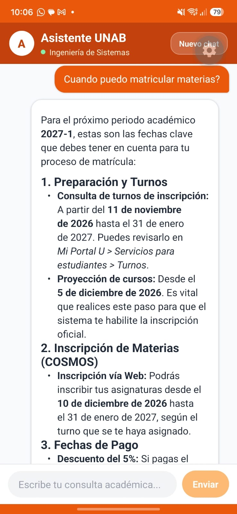

> **Descripción de captura:** Pantalla de la aplicación Android demostrando el funcionamiento del filtro de seguridad (rechazo de mensaje no válido o fuera de tema) y una respuesta rápida de pregunta frecuente.

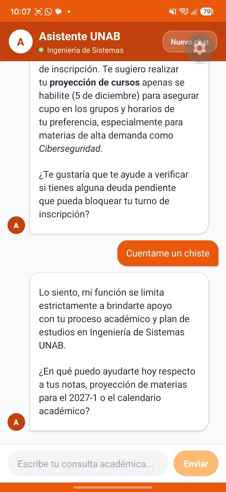

---

## 8. Manual de Instalación y Despliegue

### Prerrequisitos

* Instancia AWS EC2 (Ubuntu 22.04 LTS o superior) con Docker y Docker Compose instalados.
* Cuenta en n8n Cloud con acceso a credenciales de Google Gemini API y PostgreSQL.
* Android Studio (para configurar y ejecutar un emulador de la aplicación móvil).

### Paso 1: Despliegue de Servicios en AWS EC2

Clonar el repositorio en la instancia EC2 y acceder al directorio del proyecto:

```bash
git clone <URL_DEL_REPOSITORIO>
cd chatbot-academico-unab
```

Crear el archivo de variables de entorno local y reemplazar su valor de ejemplo por una contraseña segura:

```bash
cp .env.example .env
```

Levantar los contenedores de PostgreSQL (pgvector), servidor MCP (supergateway) y túneles inversos:

```bash
docker compose up -d
```

Cargar el esquema de base de datos, habilitar extensiones y poblar los datos iniciales:

```bash
docker compose exec -T postgres psql -U unab_admin -d unab_academico < database/schema.sql
docker compose exec -T postgres psql -U unab_admin -d unab_academico < database/seed.sql
```

Obtener las URLs activas de los túneles de Cloudflare (MCP) y Pinggy (PostgreSQL):

```bash
echo "MCP: $(docker compose logs tunnel-mcp | grep -o 'https://[a-zA-Z0-9-]*\.trycloudflare\.com' | tail -n 1)/mcp"
echo "POSTGRES: $(docker compose logs tunnel-postgres | grep -o 'tcp://[^ ]*' | tail -n 1)"
```

### Paso 2: Configuración en n8n Cloud

* Importar el archivo JSON del flujo ubicado en `workflows/Chatbot-Academico.json`.
* Importar el flujo de embeddings ubicado en `workflows/Ingesta-RAG-UNAB.json`.
* Configurar la credencial de Google Gemini(PaLM) Api con la clave de API correspondiente.
* Configurar la credencial de Postgres utilizando el Host y Puerto obtenidos del túnel TCP de Pinggy.
* Actualizar la URL del endpoint en el nodo MCP Client con la dirección HTTPS generada por Cloudflare terminada en `/mcp`.
* Guardar y activar el flujo mediante el botón Publish.

### Paso 3: Configuración de la Aplicación Android

* El proyecto móvil en `android-app/` usa Expo y React Native. Instalar dependencias y abrir la aplicación en el emulador Android:

  ```bash
  cd android-app
  npm install
  npm run android
  ```

* Verificar en la clase de configuración de red que la URL base apunte al endpoint de producción del webhook de n8n (`/webhook/unab-chat`).
* Ejecutar la aplicación en un emulador o dispositivo Android con acceso a internet.

---

## 9. Manual de Usuario

### Inicio de Interacción

1. Abra la aplicación Asistente Académico UNAB en su dispositivo Android.
2. En la barra inferior de texto, escriba su consulta en lenguaje natural y presione el botón de envío.

### Ejemplos de Consultas Soportadas

* **Estado Académico:** "¿Cuál es mi promedio acumulado actual y cuántos créditos llevo aprobados?"
* **Proyección de Matrícula:** "¿Qué materias puedo inscribir el próximo semestre teniendo en cuenta mis prerrequisitos?"
* **Reglamento y Calendario:** "¿Hasta qué fecha puedo cancelar una asignatura sin afectar mi promedio en el período 2026-2?"
* **Tarifas y Trámites:** "¿Cuál es el valor del crédito académico para Ingeniería de Sistemas en 2026?"
* **Recomendaciones de Estudio:** "Voy a cursar Arquitectura de Software y Bases de Datos II, ¿qué temas previos me recomiendas repasar?"

### Restricciones de Uso

* El asistente atiende exclusivamente consultas relacionadas con el programa de Ingeniería de Sistemas y la normativa de la UNAB.
* Las solicitudes ajenas al ámbito universitario o que contengan comandos no autorizados serán bloqueadas automáticamente por el sistema.
